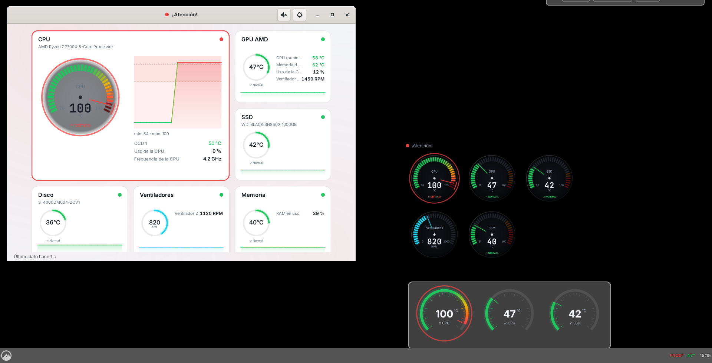
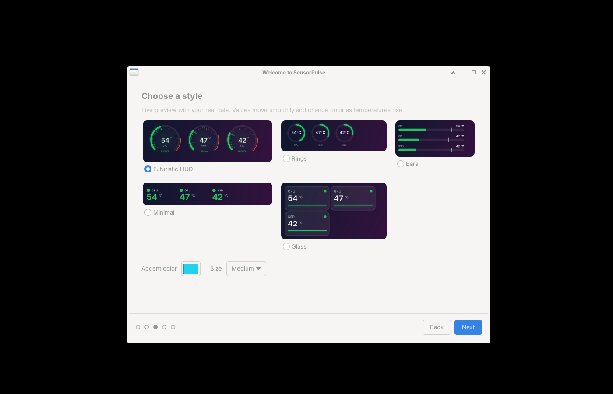

# SensorPulse

**Monitor de sensores para Debian, Ubuntu, Linux Mint y derivadas, en cualquier escritorio.**
Temperaturas de CPU, gráfica y discos, revoluciones de los ventiladores y batería, de un vistazo,
con colores que cambian según sube la temperatura y alarmas visuales y sonoras.

*English version: [README.md](README.md)*



## Qué hace

- **Tres formas de verlo** (se eligen en el asistente y se pueden combinar):
  - **en el panel**, a la izquierda de los iconos del sistema y el reloj, como nombre y número
    o como **indicadores tipo cuentakilómetros**; hasta 8 valores en la barra y el resto al
    hacer clic (eliges cuáles van en cada sitio);
  - **en una ventana** con una tarjeta por componente y gráficas de detalle;
  - **flotando en el escritorio**, con fondo transparente, donde lo coloques con el ratón.
- **Siete estilos**: Cabina (instrumento de coche con LED que se encienden en orden y cifras que
  ruedan), HUD futurista, OLED mínimo (negro puro, ideal en portátiles), Anillos, Barras,
  Minimal y Cristal.
- **Ventana «Bento»** con una tarjeta grande (gráfica y banda de mínimo y máximo), fondo
  «Aurora» opcional y tema «Oscuro profundo». Exporta el historial a CSV o JSON.
- **Alarma visual**: los indicadores y las gráficas pasan de verde a amarillo, naranja y rojo;
  en estado crítico, parpadean.
- **Alarmas que entienden tu procesador**:
  - usa la temperatura máxima de diseño de la CPU (TjMax): Intel la da el propio sensor; en
    AMD sale de una tabla con las fichas oficiales de amd.com (747 modelos); Raspberry Pi 85 °C.
    En los Ryzen con temperatura de control desplazada (1600X-1800X, 2700X, Threadripper
    1000/2000) se usa la temperatura real (Tdie);
  - umbrales de la CPU: «alto» 10 °C por debajo del TjMax y «crítico» 3 °C por encima. Como la
    CPU frena al llegar a su TjMax, casi nunca lo supera: un procesador trabajando en su límite,
    que es normal, no salta como crítico. La protección real son las dos alarmas siguientes;
  - avisa si la CPU o una NVIDIA **bajan la velocidad por calor** (contadores del hardware), y
    es crítico si la CPU pasa un minuto en su límite frenando mucho (refrigeración que falla);
  - avisa si el equipo **se calienta sin estar trabajando** (rejillas tapadas, refrigeración
    que falla) y lo trata como crítico si llega al límite casi sin carga;
  - avisa si **se para un ventilador** que estaba girando con el equipo caliente.
- **Tres niveles**: informativo (solo color), aviso (notificación) y crítico (notificación y
  **sonido**). Durante juegos o vídeos a pantalla completa solo interrumpen las críticas.
- **Alarmas propias** («avísame si la CPU pasa de 75 °C durante 10 segundos»), con retardo e
  histéresis. Las notificaciones traen botones **Silenciar 1 hora** y **Detalles**.
- **Registro de alarmas** que se guarda (hora, sensor, duración).
- **Historial de hasta 30 días** (10 min, 1 hora, 24 horas, 7 días, 30 días) con mínimo y máximo.
- Cada valor lleva **símbolo y palabra** además del color (✓ Normal, ⚠ Alto, ‼ Crítico), para
  daltonismo y paneles monocromo, y se puede leer con el lector de pantalla Orca.
- **Eliges qué sensores se ven**, dónde (panel, al hacer clic en el panel, ventana, flotante) y
  con qué nombre: «diode 0» puede llamarse «Placa base», desde el asistente, desde Ajustes o
  directamente desde el panel y el widget del escritorio (botón derecho).
- **Ventiladores (RPM)** de la placa base, de portátiles que los publican y de las gráficas.
- **Asistente de bienvenida** que explica y deja elegir qué va al panel y qué al widget del
  escritorio, con todas las opciones de sonido, y botón **«Usar lo recomendado y terminar»**.
- **15 sonidos de alarma**, entre ellos una **alarma de central nuclear**, con un botón ▶ junto
  a cada selector para escucharlos antes de elegir.
- **«Detectar sensores»**: activa con una sola contraseña los sensores de placa base y de
  discos SATA que el sistema no carga solo, sin abrir el terminal.
- **Applet y desklet de Cinnamon** y **extensión de GNOME** incluidos: muestran exactamente lo
  mismo que el programa (sensores elegidos, nombres, °C/°F, colores para daltonismo).
- **Sigue el tema claro u oscuro** del sistema.
- **Informe del equipo anónimo** (Ajustes › Acerca de) para pegarlo en un foro.
- **Órdenes de terminal**: `sensorpulse status`, `sensorpulse status --json`, `sensorpulse report`
  y `sensorpulse export ID`.
- **Respeta «No molestar»** del escritorio y «reducir animaciones».
- **Idiomas**: español, inglés, francés, italiano, alemán, portugués, japonés y chino (se
  detecta solo).
- **Ligero**: el widget flotante guarda ya dibujado lo que no cambia; con el estilo «Cristal» y
  la gráfica llena gasta menos del 1 % de un núcleo.

## Lo que no hace (a propósito)

- **No necesita root** y no pide contraseña para funcionar (solo «Detectar sensores» y
  desinstalar la piden, una vez).
- **No despierta una gráfica dedicada en reposo**: antes de leerla comprueba si está dormida.
  En portátiles con dos gráficas cierra la conexión con NVIDIA después de cada lectura y la
  lee cada 30 segundos, para que pueda volver a dormirse.
- **Cada disco según su tipo**: los NVMe y los SSD SATA se leen a menudo (leerlos no afecta a
  su reposo ni a su vida útil). En los discos duros, leer la temperatura puede reiniciar el
  contador de apagado, así que el intervalo lo eliges tú (30 minutos por defecto, desde 2); si
  un disco duro está templado se vigila cada 2 minutos hasta que se enfríe.
- **Portátiles Dell, ThinkPad, HP, ASUS y Mac**: sus sensores hablan con el firmware y pueden
  causar tirones de audio si se leen muy seguido; se leen cada 10 segundos y, si una lectura
  tarda, todavía más despacio.
- **Solo lee los sensores que muestras** o que usan tus alarmas.
- **No controla ventiladores ni cambia nada del hardware**: solo lee.
- **No envía datos a internet.**



## Instalación

Descarga el `.deb` de la página de [versiones](https://github.com/MintMotion/sensorpulse/releases)
e instálalo con doble clic o con:

```
sudo apt install ./sensorpulse_0.3.0_all.deb
```

Después ábrelo desde el menú (o espera al siguiente inicio de sesión): aparecerá el asistente.

**Requisitos**: Debian 12 o posterior, Ubuntu 22.04 o posterior, Linux Mint 21 / LMDE 6 o
posterior (o derivadas), Python 3.8 o posterior y GTK 3. Las dependencias se instalan solas.

### Notas por escritorio

| Escritorio | Panel | Flotante |
|---|---|---|
| Cinnamon | applet propio (se añade solo al panel) | ventana transparente; en Wayland, desklet propio |
| Xfce, MATE, Budgie, LXQt | icono con valores | ventana transparente (con el compositor activo) |
| KDE Plasma | icono con valores | ventana transparente (en Wayland, capa de escritorio) |
| GNOME 45 o posterior | extensión propia en la barra superior | ventana transparente; en Wayland, ventana normal |
| GNOME 44 o anterior | necesita la extensión «AppIndicator» | igual que arriba |

En X11 el widget flotante es una ventana de tipo «dock» por debajo de las demás: no
desaparece con «Mostrar escritorio» (probado en Muffin, xfwm4 y Marco). La extensión de
GNOME se ha probado en GNOME 46; la primera vez puede hacer falta cerrar la sesión y volver
a entrar.

## Datos que lee

| Componente | De dónde |
|---|---|
| CPU Intel / AMD | `coretemp`, `k10temp`, `k8temp`, `zenpower` (hwmon) |
| Gráfica AMD / Intel / nouveau | hwmon de `amdgpu`, `radeon`, `i915`, `xe`, `nouveau` |
| Gráfica NVIDIA (driver propietario) | NVML (`libnvidia-ml.so.1`), solo con la gráfica despierta |
| SSD NVMe | hwmon del driver `nvme` |
| Discos SATA | módulo `drivetemp` (lo activa «Detectar sensores») |
| Placa base y ventiladores | `nct67xx`, `it87`, `asus-ec-sensors`, `thinkpad`, `dell-smm`, `applesmc`… |
| Batería | `/sys/class/power_supply` |
| Sin hwmon (ARM, Raspberry Pi) | zonas térmicas del kernel |

Si un componente no aparece, prueba **Ajustes › Sensores › Detectar sensores**. Si sigue sin
aparecer, normalmente es porque el kernel no tiene todavía su controlador (hardware muy nuevo)
o porque el fabricante no publica el dato para Linux.

El historial se guarda en `~/.local/state/sensorpulse/history.sqlite` (medias por minuto
7 días y cada 10 minutos 30 días); se escribe una vez por minuto.

## Desarrollo

```
python3 -m sensorpulse.app                 # ejecutar desde el código
python3 tests/test_core.py                 # pruebas del núcleo con sensores simulados
python3 -m sensorpulse.cli status --json   # valores actuales
python3 tools/fake_sysfs.py /tmp/falso desktop
SENSORPULSE_SYSROOT=/tmp/falso python3 -m sensorpulse.app   # probar sin el hardware
packaging/build-deb.sh                     # crear el .deb
```

Arquitectura: un servicio de usuario (`sensorpulse-service`) lee los sensores, evalúa las
alarmas y publica los datos por D-Bus de sesión (`io.github.mintmotion.SensorPulse`); la
ventana, el panel, el flotante, el applet y el desklet solo leen de él.

## Autor y licencia

SensorPulse

Licencia MIT. Software libre y gratuito. No soy programador: lo he hecho con ayuda de Claude.
Las ideas, mejoras y correcciones son bienvenidas.
