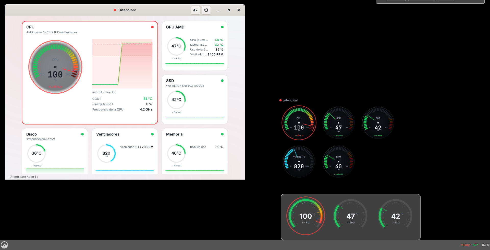
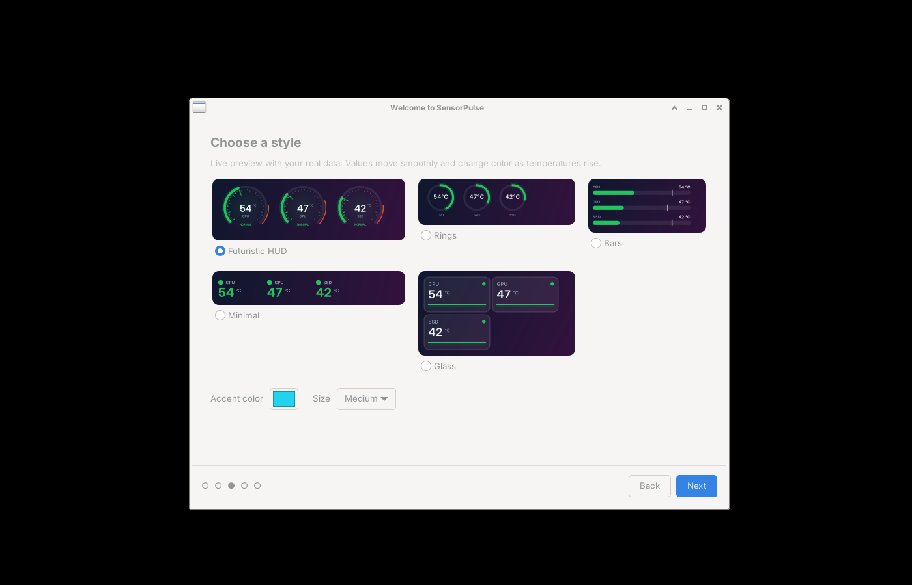

# SensorPulse

**Sensor monitor for Debian, Ubuntu, Linux Mint and derivatives, on any desktop.**
CPU, GPU and disk temperatures, fan speeds and battery at a glance, with colors that change
as temperatures rise and visual and sound alarms.

*Versión en español: [README.es.md](README.es.md)*



## What it does

- **Three ways to see it** (chosen in the assistant, can be combined):
  - **in the panel**, to the left of the system icons and the clock, as name and number or as
    **odometer-style gauges**; up to 8 values in the bar and the rest on click (you choose
    which go where);
  - **in a window** with one card per component and detailed charts;
  - **floating on the desktop**, with a transparent background, wherever you drop it.
- **Seven styles**: Cockpit (car-like gauge with LEDs lighting up in order and rolling digits),
  Futuristic HUD, OLED minimal (pure black, ideal for laptops), Rings, Bars, Minimal and Glass.
- **Bento window** with one large card (chart and min/max band), optional Aurora background and a
  Deep dark theme. History export to CSV or JSON.
- **Visual alarm**: gauges and charts go from green to yellow, orange and red; they blink when critical.
- **Alarms that understand your processor**:
  - uses the CPU design limit (TjMax): Intel reports it through its sensor; for AMD it comes
    from a table built from the official amd.com specifications (747 models); Raspberry Pi
    85 °C. On Ryzen models with an offset control temperature (1600X-1800X, 2700X,
    Threadripper 1000/2000) the real temperature (Tdie) is used;
  - CPU thresholds: "high" 10 °C below TjMax and "critical" 3 °C above it. Since the CPU slows
    down when it reaches TjMax it rarely exceeds it: a processor working at its limit, which is
    normal, does not trigger a critical alarm. The real protection is the next two alarms;
  - warns when the CPU or an NVIDIA GPU **slows down because of heat** (hardware counters),
    and it is critical if the CPU spends a minute at its limit slowing down hard (failing cooling);
  - warns when the computer **gets hot while almost idle** (blocked vents, failing cooling)
    and treats it as critical if it reaches the limit with almost no load;
  - warns when a **fan that was spinning stops** while the computer is hot.
- **Three levels**: informative (color only), warning (notification) and critical
  (notification and **sound**). During games or full-screen videos only critical alarms interrupt.
- **Custom alarms** ("warn me if the CPU goes above 75 °C for 10 seconds") with delay and
  hysteresis. Notifications have **Mute 1 hour** and **Details** buttons.
- **Alarm log** that is kept (time, sensor, duration).
- **Up to 30 days of history** (10 min, 1 hour, 24 hours, 7 days, 30 days) with min and max.
- Every value has a **symbol and a word** besides its color (✓ Normal, ⚠ High, ‼ Critical) for
  color blindness and monochrome panels, and can be read by the Orca screen reader.
- **Choose which sensors are shown**, where (panel, panel on click, window, floating) and how
  they are named: "diode 0" can become "Motherboard", from the assistant, from Settings or
  right from the panel and the desktop widget (right-click).
- **Fan speeds (RPM)** from motherboards, laptops that publish them and graphics cards.
- **Welcome assistant** that explains and lets you choose what goes to the panel and what to the
  desktop widget, with every sound option, and a **"Use recommended settings and finish"** button.
- **15 alarm sounds**, including a **nuclear plant alarm**, with a ▶ button next to every
  sound selector to listen before choosing.
- **"Detect sensors"**: enables, with a single password prompt, the motherboard and SATA disk
  sensors that the system does not load by itself, without opening a terminal.
- **Cinnamon applet and desklet** and **GNOME extension** included.
- **Follows the system light or dark theme.**
- **Anonymous hardware report** (Settings › About) to paste in a forum.
- **Terminal commands**: `sensorpulse status`, `sensorpulse status --json`, `sensorpulse report`
  and `sensorpulse export ID`.
- **Respects Do Not Disturb** and reduced motion.
- **Languages**: Spanish, English, French, Italian, German, Portuguese, Japanese and Chinese
  (detected automatically).
- **Lightweight**: the floating widget keeps what does not change already drawn; with the
  "Glass" style and a full chart it uses less than 1 % of one CPU core.

## What it does not do (on purpose)

- **No root needed**, no password to run (only "Detect sensors" and uninstalling ask for it, once).
- **Never wakes up a sleeping dedicated GPU**. On dual-GPU laptops it closes the NVIDIA
  connection after each reading and reads it every 30 seconds, so the GPU can go back to sleep.
- **Each disk by its type**: NVMe and SATA SSDs are read often (it does not affect their rest or
  lifespan). On hard disks reading the temperature can reset the spin-down timer, so you choose
  the interval (30 minutes by default, down to 2); a warm hard disk is watched every 2 minutes
  until it cools down.
- **Dell, ThinkPad, HP, ASUS and Mac laptops**: their sensors talk to the firmware and can cause
  audio stutter if read too often; they are read every 10 seconds, and slower if a read is slow.
- **Only reads the sensors you show** or your alarms use.
- **Never controls fans or changes hardware settings**: read-only.
- **Sends nothing to the internet.**



## Install

Download the `.deb` from [releases](https://github.com/MintMotion/sensorpulse/releases) and
open it, or run:

```
sudo apt install ./sensorpulse_0.3.8_all.deb
```

Then open it from the menu (or wait until the next login): the welcome assistant appears.

**Requirements**: Debian 12+, Ubuntu 22.04+, Linux Mint 21 / LMDE 6+ (or derivatives),
Python 3.8+ and GTK 3. Dependencies are installed automatically.

### Notes per desktop

| Desktop | Panel | Floating |
|---|---|---|
| Cinnamon | its own applet (added to the panel automatically) | transparent window; on Wayland, its own desklet |
| Xfce, MATE, Budgie, LXQt | icon with values | transparent window (with the compositor on) |
| KDE Plasma | icon with values | transparent window (on Wayland, desktop layer) |
| GNOME 45 or later | its own extension in the top bar | transparent window; on Wayland, normal window |
| GNOME 44 or earlier | needs the "AppIndicator" extension | same as above |

On X11 the floating widget is a "dock" window below the others, so "Show desktop" does not hide
it (tested on Muffin, xfwm4 and Marco). The GNOME extension has been tested on GNOME 46; the
first time you may need to log out and back in.

## Data it reads

| Component | From |
|---|---|
| Intel / AMD CPU | `coretemp`, `k10temp`, `k8temp`, `zenpower` (hwmon) |
| AMD / Intel / nouveau graphics | hwmon from `amdgpu`, `radeon`, `i915`, `xe`, `nouveau` |
| NVIDIA graphics (proprietary driver) | NVML (`libnvidia-ml.so.1`), only while the GPU is awake |
| NVMe SSD | hwmon from the `nvme` driver |
| SATA disks | `drivetemp` module ("Detect sensors" enables it) |
| Motherboard and fans | `nct67xx`, `it87`, `asus-ec-sensors`, `thinkpad`, `dell-smm`, `applesmc`… |
| Battery | `/sys/class/power_supply` |
| No hwmon (ARM, Raspberry Pi) | kernel thermal zones |

If a component does not appear, try **Settings › Sensors › Detect sensors**. If it still does
not appear, it is usually because the kernel does not have its driver yet (very new hardware) or
because the manufacturer does not publish the value for Linux.

History is kept in `~/.local/state/sensorpulse/history.sqlite` (1-minute averages for 7 days,
10-minute averages for 30 days), written once a minute.

## Development

```
python3 -m sensorpulse.app                 # run from the source code
python3 tests/test_core.py                 # core tests with simulated sensors
python3 -m sensorpulse.cli status --json   # current values
python3 tools/fake_sysfs.py /tmp/fake desktop
SENSORPULSE_SYSROOT=/tmp/fake python3 -m sensorpulse.app   # try it without the hardware
packaging/build-deb.sh                     # build the .deb
```

A user service (`sensorpulse-service`) reads the sensors, evaluates alarms and publishes the
data on the session D-Bus (`io.github.mintmotion.SensorPulse`); the window, panel icon,
floating widget, Cinnamon applet and desklet and GNOME extension only read from it.

## Author and license

SensorPulse

MIT License. Free and open source. I am not a programmer: I made it with the help of Claude.
Ideas, improvements and fixes are welcome.
